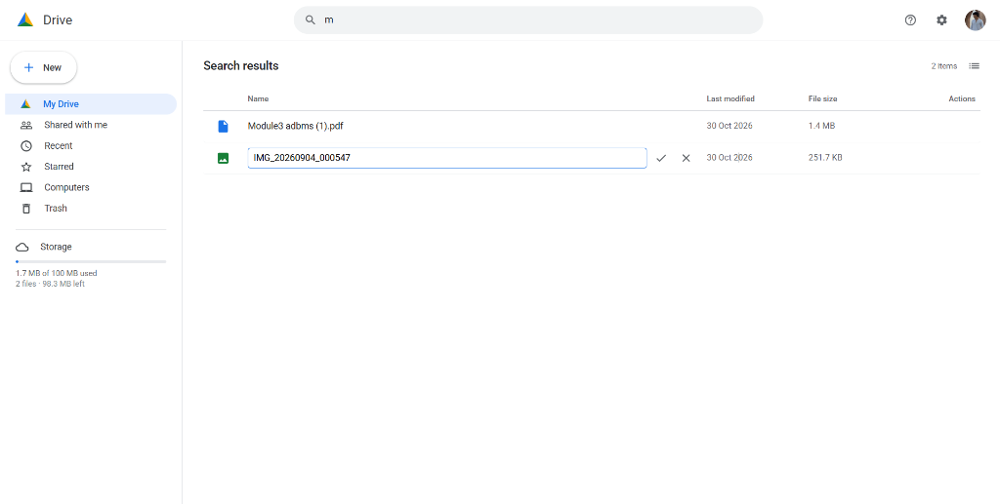

# Google Drive Clone


A production-ready, full-stack cloud file management platform inspired by Google Drive. Built with React 18, Vite, Google Cloud Firestore, Firebase Authentication, and Cloudinary Cloud Storage. The system delivers complete user-level data isolation, hierarchical folder organization, collaborative file sharing with granular permissions, in-app multimedia previews, drag-and-drop uploads, trash recovery, and dynamic storage quota tracking.

---

## Table of Contents

- [Overview](#overview)
- [Screenshots & Preview](#screenshots--preview)
- [Key Features](#key-features)
- [Tech Stack](#tech-stack)
- [System Architecture](#system-architecture)
- [Project Structure](#project-structure)
- [Installation & Setup](#installation--setup)
  - [Prerequisites](#prerequisites)
  - [Environment Configuration](#environment-configuration)
  - [Firebase Configuration](#firebase-configuration)
  - [Cloudinary Setup](#cloudinary-setup)
  - [Running Locally](#running-locally)
- [Application Workflows](#application-workflows)
- [Security & Access Control](#security--access-control)
- [Future Enhancements](#future-enhancements)
- [Contributing](#contributing)
- [License](#license)

---

## Overview

Most tutorial file manager implementations store metadata client-side or share a single global storage bucket without access control. This project implements an enterprise-grade cloud storage pattern:
- **Client-Direct Binary Pipeline:** Files stream directly from the browser to Cloudinary CDN via unsigned secure REST endpoints, eliminating intermediate server bottlenecks.
- **Relational Metadata Layer:** File records, folder paths, permissions, and audit timestamps are managed in Google Cloud Firestore with real-time `onSnapshot` subscriptions.
- **Server-Enforced Access Control:** Firestore security rules enforce ownership and sharing boundaries at the database level, preventing unauthorized access regardless of client state.
- **Interactive Multimedia Workspace:** High-fidelity in-browser rendering for images, PDFs, videos, and audio.

---

## Screenshots & Preview

### Application Dashboard & File Manager
The main interface displays active files, folder hierarchies, real-time search filtering, storage indicators, and quick-action toolbars.

<p align="center">
  
</p>
<p align="center"><em>Figure 1: Google Drive Clone interface showcasing file listing, inline renaming, search filtering, and storage quota management.</em></p>

---

## Key Features

### 1. File & Folder Lifecycle Management
- **Individual & Batch Uploads:** Select one or multiple files simultaneously with individual progress tracking.
- **Drag-and-Drop:** Native HTML5 drag-and-drop dropzone anywhere in the workspace.
- **Nested Folder Hierarchy:** Create folders, navigate through directories with interactive breadcrumbs (`My Drive / Folder / Subfolder`), and return to root in one click.
- **Move Items:** Move files and directories across folders with a dedicated destination selector dialog.
- **File Duplication:** Generate instantaneous file copies (`Copy of <filename>`) without re-uploading binary assets.
- **Inline Renaming:** Rename files and folders directly from table rows with keyboard accessibility (`Enter` to save, `Esc` to cancel).
- **Direct Downloads:** Stream and download uploaded files securely via Cloudinary's global CDN.

### 2. Multimedia Previews
- **Images:** High-resolution preview modal with responsive aspect ratios (`PNG`, `JPG`, `JPEG`, `GIF`, `WebP`, `SVG`).
- **PDF Documents:** Embedded PDF viewing via secure sandboxed iframes.
- **Video Player:** HTML5 hardware-accelerated playback for `MP4`, `WebM`, and `MOV` files.
- **Audio Player:** In-app audio player for `MP3`, `WAV`, and `OGG` files.
- **Generic Documents:** Automatic fallback with file metadata inspection and instant download actions.

### 3. Sidebar Sections & Organization
- **My Drive:** View all active personal files and folders.
- **Shared with me:** Live feed of files shared by other authenticated users, displaying owner names and assigned roles.
- **Recent:** Chronologically ordered list by `lastAccessed` and `timestamp`.
- **Starred:** Filtered repository of critical items with persistent star/unstar toggles.
- **Trash & Lifecycle Recovery:** Two-phase deletion system (soft-delete to Trash, restore to original path, permanent deletion, or bulk "Empty Trash").
- **Storage Management:** Live 100MB per-account quota bar that updates dynamically upon uploads, trash actions, and permanent deletions.

### 4. Search, Sorting & Display Modes
- **Live Search:** Instant query filtering across file and folder names.
- **Multi-attribute Sorting:** Sort items by Name (alphabetical), Last Modified date, or File Size in Ascending or Descending order (folders remain organized on top).
- **Layout Switching:** Toggle between detailed **List View** and visual **Grid View** with card thumbnails.

### 5. Access Control & Collaboration
- **Collaborative Sharing:** Share files with registered users using their Google email addresses.
- **Role Permissions:** Granular permissions (`Viewer` vs `Editor`).
- **Shareable Link Generation:** One-click link copying to clipboard with toast notifications.
- **Access Revocation:** File owners can inspect collaborator lists and revoke access permissions at any time.

---

## Tech Stack

| Domain | Technology | Description |
|---|---|---|
| **Frontend Framework** | React 18.2 | Component-based UI architecture with hooks and state management |
| **Build & Tooling** | Vite 5.2 | High-performance bundling, development server, and HMR |
| **Styling** | Tailwind CSS 3.4 & PostCSS | Utility-first responsive CSS styling with custom Drive color palette |
| **Component Suite** | Material UI (MUI) v5 | `@mui/material`, `@mui/icons-material`, `@mui/base`, `@emotion/react` |
| **Authentication** | Firebase Auth v8 | Google OAuth 2.0 popup authentication and session management |
| **Database** | Google Cloud Firestore | NoSQL document database with real-time WebSocket subscriptions |
| **Object Storage** | Cloudinary REST API | Direct client-side unsigned multipart uploads to CDN storage |
| **Code Quality** | ESLint 8 | Strict linting rules with React Hooks and Refresh verification |

---

## System Architecture

The application implements a decoupled, serverless multi-cloud architecture:

```mermaid
flowchart TD
    subgraph Client["Browser Client (React 18 + Vite)"]
        UI["UI Layer (Header, Sidebar, Data View, Modals)"]
        State["State Manager (Auth, Active Section, Folder Context)"]
        UploadCtrl["Upload Controller (Multipart / Form Data)"]
    end

    subgraph GoogleCloud["Google Cloud Platform"]
        Auth["Firebase Authentication (Google OAuth 2.0)"]
        Firestore["Cloud Firestore (Metadata, Permissions, Hierarchy)"]
        Rules["Firestore Security Rules (Ownership & Role Enforcement)"]
    end

    subgraph MediaCloud["Cloudinary Media Cloud"]
        CDN["Binary Storage & Global Content Delivery Network"]
        Preset["Unsigned Upload Preset (google_drive_upload)"]
    end

    UI --> State
    State -->|1. Authenticate| Auth
    State -->|2. Real-time sync (onSnapshot)| Firestore
    Firestore --- Rules
    UploadCtrl -->|3. POST multipart file stream| Preset
    Preset --> CDN
    CDN -->|4. Return secure_url & public_id| UploadCtrl
    UploadCtrl -->|5. Commit file document| Firestore
    UI -->|6. Stream media & previews| CDN
```

### Data Flow Overview
1. **Authentication:** The client initiates Google Sign-In via Firebase Auth. Upon success, Firebase returns an identity token and `user.uid`.
2. **Binary Upload:** Selected or dropped files are uploaded directly from the browser to Cloudinary via HTTPS POST requests using an unsigned upload preset.
3. **Metadata Commit:** Upon receiving the Cloudinary `secure_url` and `public_id`, the client creates a document in Firestore collection `myfiles` with owner metadata, folder relationships, and access lists.
4. **Real-Time Sync:** Firestore pushes changes instantaneously to all active clients subscribed to the `myfiles` collection via WebSocket listeners.

---

## Project Structure

```
Google_Drive/
├── .github/                      # CI/CD workflow configurations
│   └── workflows/
│       ├── ci.yml                # Lint and build validation
│       └── deploy.yml            # Deployment automation
├── public/                       # Static public assets
│   ├── fav.png                   # Application favicon
│   └── vite.svg                  # Vite brand asset
├── screenshots/                  # Project preview screenshots
│   └── dashboard.png             # Application interface screenshot
├── src/                          # Application source code
│   ├── assets/                   # Vector assets
│   ├── components/               # Core application modals & dialogs
│   │   ├── MoveModal.jsx         # Folder relocation dialog
│   │   ├── PreviewModal.jsx      # Universal media preview modal
│   │   ├── SettingsModal.jsx     # Storage and cloud status dialog
│   │   ├── ShareModal.jsx        # Access control & link sharing dialog
│   │   └── Toast.jsx             # Floating notification system
│   ├── css/                      # Component-specific styles
│   │   ├── data.css              # File tables, grid cards, and dropzone styles
│   │   ├── Header.css            # Navigation bar and search styling
│   │   └── sidebar.css           # Sidebar menu, progress bar, and modal tabs
│   ├── App.jsx                   # Global state, router, and modal coordinator
│   ├── Data.jsx                  # Main content viewport (List/Grid views)
│   ├── firebase.js               # Safe Firebase SDK configuration and export
│   ├── Header.jsx                # Top bar with search, settings, and profile
│   ├── index.css                 # Global CSS and Tailwind directives
│   ├── main.jsx                  # React application entry point
│   └── Sidebar.jsx               # Navigation drawer and batch upload triggers
├── .env.example                  # Template for required environment variables
├── .eslintrc.cjs                 # ESLint linter configuration
├── .firebaserc                   # Firebase project mapping
├── database.rules.json           # Realtime database rules fallback
├── firebase.json                 # Firebase deployment configuration
├── firestore.rules               # Server-enforced Firestore security rules
├── index.html                    # Root HTML document
├── package.json                  # Dependencies and execution scripts
├── postcss.config.js             # PostCSS plugin definitions
├── tailwind.config.js            # Tailwind theme extensions and tokens
└── vite.config.js                # Vite build and plugin configuration
```

---

## Installation & Setup

### Prerequisites
- **Node.js:** v18.0.0 or higher
- **npm:** v9.0.0 or higher
- A **Firebase** project with Authentication (Google Sign-In) and Cloud Firestore enabled.
- A free **Cloudinary** account.

### 1. Clone & Install Dependencies

```bash
git clone https://github.com/mkhalidh/Google_Drive.git
cd Google_Drive
npm install
```

### 2. Environment Configuration

Create a `.env` file in the root directory:

```bash
cp .env.example .env
```

Populate the `.env` file with your credentials:

```env
# Firebase Web App Configuration
VITE_FIREBASE_API_KEY=your_firebase_api_key
VITE_FIREBASE_AUTH_DOMAIN=your_project_id.firebaseapp.com
VITE_FIREBASE_PROJECT_ID=your_project_id
VITE_FIREBASE_STORAGE_BUCKET=your_project_id.firebasestorage.app
VITE_FIREBASE_MESSAGING_SENDER_ID=your_messaging_sender_id
VITE_FIREBASE_APP_ID=your_app_id
VITE_FIREBASE_MEASUREMENT_ID=your_measurement_id

# Cloudinary Unsigned Upload Configuration
VITE_CLOUDINARY_CLOUD_NAME=your_cloudinary_cloud_name
VITE_CLOUDINARY_UPLOAD_PRESET=your_unsigned_preset_name
```

> **Security Note:** Never commit your production `.env` file to version control. The `.gitignore` file is configured to exclude it.

### 3. Firebase Configuration

1. **Authentication:**
   - Go to [Firebase Console](https://console.firebase.google.com/) ➔ **Authentication** ➔ **Sign-in method**.
   - Enable the **Google** provider and configure your support email.
   - Under **Settings** ➔ **Authorized domains**, ensure `localhost` is listed.

2. **Cloud Firestore:**
   - Go to **Firestore Database** ➔ **Create Database**.
   - Deploy the security rules from `firestore.rules`:
     ```bash
     firebase deploy --only firestore:rules
     ```
     *(Or paste the contents of `firestore.rules` directly into Firebase Console ➔ Firestore ➔ Rules).*

### 4. Cloudinary Setup

1. Log into your [Cloudinary Console](https://cloudinary.com/console) and copy your **Cloud Name**.
2. Navigate to **Settings** ➔ **Upload** ➔ scroll to **Upload presets**.
3. Click **Add upload preset**:
   - **Upload preset name:** Enter a name (e.g., `google_drive_upload`).
   - **Signing Mode:** Select **Unsigned** *(required for client-side uploads without exposing your API secret)*.
   - Click **Save**.

### 5. Running Locally

Start the Vite development server:

```bash
npm run dev
```

Open your browser and navigate to:
```
http://localhost:5173/
```

### Additional Commands

```bash
npm run build      # Compile production build to /dist
npm run lint       # Run ESLint validation
npm run preview    # Locally preview production build
```

---

## Application Workflows

### 1. Upload & Storage Pipeline
1. The user selects files via the "+ New" button or drops them into the browser.
2. The client checks if the batch size exceeds the remaining 100MB account quota.
3. If valid, the file is posted directly to Cloudinary's secure upload API.
4. Cloudinary processes the binary, assigns a permanent CDN URL, and returns metadata.
5. The client writes a document to Firestore's `myfiles` collection with `uid`, `filename`, `fileUrl`, `fileType`, `size`, and `parentFolderId`.

### 2. Hierarchical Folder Navigation
1. Folders are persisted as documents with `isFolder: true` and `size: 0`.
2. When a folder is clicked, `currentFolder` is updated in state, causing Firestore views to display only items matching `parentFolderId == currentFolder.id`.
3. The breadcrumb component dynamically reconstructs the navigation path.

### 3. Collaborative Sharing
1. An owner opens the Share dialog and specifies a collaborator's email and role (`viewer` or `editor`).
2. Firestore updates the document's `sharedEmails` array and `sharedWith` metadata.
3. On the collaborator's client, the `Shared with me` listener automatically receives the file via the `array-contains` query.

---

## Security & Access Control

### Firestore Security Rules
All database read, write, and delete operations are validated server-side by rules defined in [`firestore.rules`](file:///c:/Users/Rohith/OneDrive/Desktop/Google_Drive-main/Google_Drive-main/firestore.rules):

```javascript
rules_version = '2';
service cloud.firestore {
  match /databases/{database}/documents {
    match /myfiles/{fileId} {
      // Owners or collaborators listed in sharedEmails can read
      allow read: if request.auth != null && (
        request.auth.uid == resource.data.uid ||
        (resource.data.sharedEmails != null && request.auth.token.email in resource.data.sharedEmails)
      );
      
      // Only authenticated users can create files tagged with their own uid
      allow create: if request.auth != null && request.auth.uid == request.resource.data.uid;
      
      // Owners or editors can update metadata (rename, move, share)
      allow update: if request.auth != null && (
        request.auth.uid == resource.data.uid ||
        (resource.data.sharedEmails != null && request.auth.token.email in resource.data.sharedEmails)
      );
      
      // Only the genuine owner can delete the document
      allow delete: if request.auth != null && request.auth.uid == resource.data.uid;
    }
  }
}
```

### Credentials Safety
- **No Secret Leakage:** The Cloudinary API Secret is **never** included or referenced in client-side source code. Unsigned upload presets handle direct uploads securely.
- **Environment Isolation:** All sensitive keys are loaded via Vite's `import.meta.env` system and kept out of version control.

---

## Future Enhancements

- [ ] **Chunked Resumable Uploads:** Support for multi-gigabyte files using Tus or Cloudinary chunked upload protocols.
- [ ] **Folder Downloads:** Client-side zip compression (`JSZip`) for downloading complete folder trees.
- [ ] **Activity & Audit Log:** Chronological event feed detailing when files were viewed, edited, or downloaded.
- [ ] **Dark Mode:** System-adaptive theme switching using Tailwind dark mode variants.
- [ ] **Full-Text Document Search:** In-content search indexing using Cloud Functions and Algolia/Elasticsearch.

---

## Contributing

Contributions are welcome. To contribute:

1. Fork the repository.
2. Create a feature branch:
   ```bash
   git checkout -b feature/your-feature-name
   ```
3. Commit your changes:
   ```bash
   git commit -m "feat: describe your change"
   ```
4. Push to your branch:
   ```bash
   git push origin feature/your-feature-name
   ```
5. Open a Pull Request with a clear summary of modifications.

---

## License

This project is licensed under the [MIT License](LICENSE).
